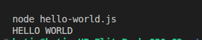
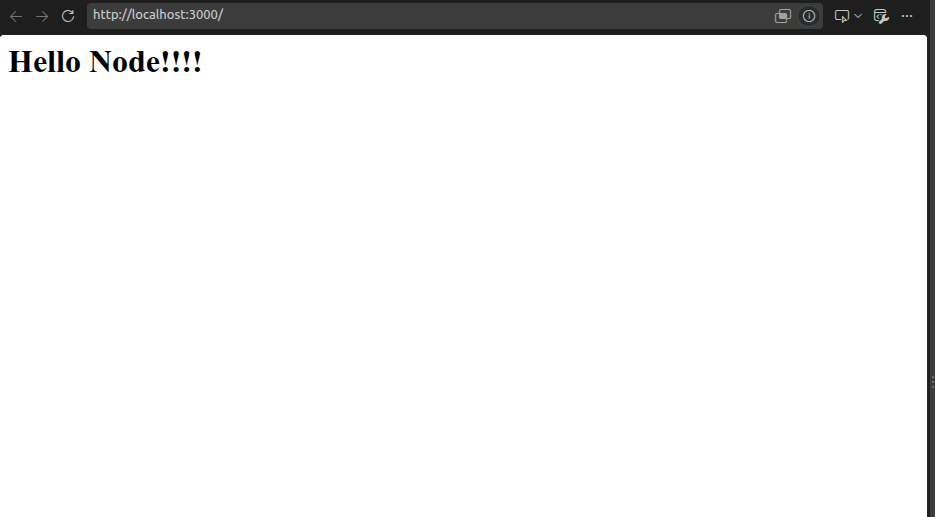
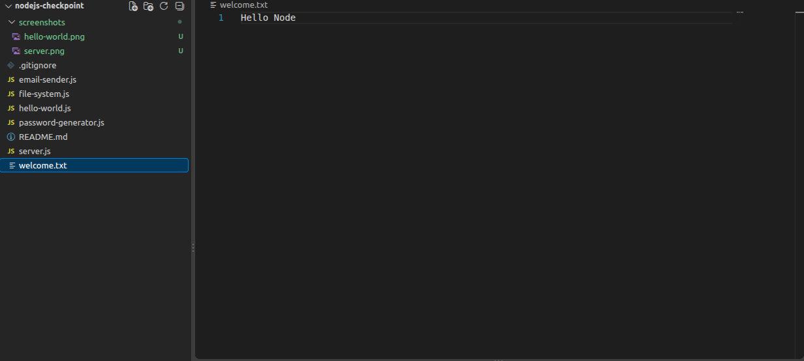
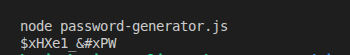

# Node.js Checkpoint

This project contains five exercises to practice Node.js, HTTP servers, file systems, password generation, and email sending.

## Exercises

1. **Hello World:** Prints `HELLO WORLD`.
2. **HTTP Server:** Displays `Hello Node!!!!` at `http://localhost:3000`.
3. **File System:** Creates and reads `welcome.txt`.
4. **Password Generator:** Generates a random password using `generate-password`.
5. **Email Sender:** Sends an email using Nodemailer.

## Screenshots

### 1. Hello World

### 2. HTTP Server

### 3. File System

### 4. Password Generator

